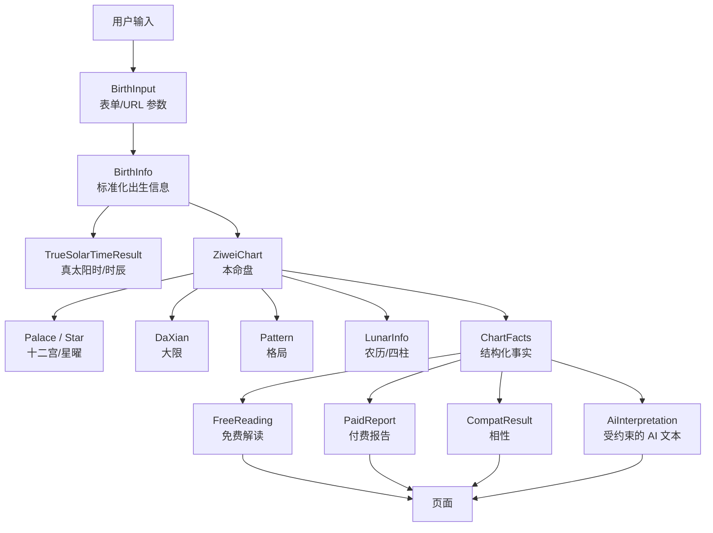

# 领域模型

> 目的：让 AI 知道系统里有哪些核心对象、它们怎么流动、哪些是事实、哪些是表达。
> **事实以 TypeScript 类型为准**；本文是导航，不是另一套 schema。

---

## 1. 一张图



---

## 2. 核心对象

| 对象 | 真实类型/位置 | 作用 | 下游 |
|---|---|---|---|
| `BirthInput` | `ZhBirthInput` / `JpBirthInput`（`lib/zh/birth.ts`、`lib/jp/birth.ts`） | 用户填的原始字段 | `BirthInfo` |
| `TrueSolarTimeResult` | `lib/ziwei/true-solar-time.ts` | 真太阳时、时辰、换日偏移 | `BirthInfo` |
| `BirthInfo` | `lib/ziwei/types.ts` | 排盘用的标准化出生信息（含 `origInput`） | `ZiweiChart` |
| `LunarInfo` | `lib/ziwei/types.ts` | 农历、干支、四柱 | 流年/四柱 |
| `ZiweiChart` | `lib/ziwei/types.ts` | 本命盘（12 宫、大限、五行局） | `ChartFacts` |
| `Palace` | `lib/ziwei/types.ts` | 宫位、星曜、空宫/借对宫 | `PalaceFact` |
| `Star` | `lib/ziwei/types.ts` | 星曜、四化、明暗 | `StarFact` |
| `DaXian` | `lib/ziwei/types.ts` | 大限年龄/宫位/四化 | `DaxianFact` |
| `Pattern` | `lib/ziwei/patterns.ts` | 格局判定结果 | `PatternFact` |
| `ZhChartFacts` / `JpChartFacts` | `lib/zh/facts.ts` / `lib/jp/facts.ts` | 给文案用的结构化事实 | 解读/报告/相性/AI |
| `PaidReport` | `lib/zh/report.ts` / `lib/jp/report.ts` | 报告（标题/摘要/章节/结尾） | 报告页 |
| `CompatResult` | `lib/zh/compat.ts` / `lib/jp/compat.ts` | 相性结果 | 相性页 |
| `AiInterpretation` | 运行时数据（`app/api/*/interpret`） | LLM 生成的文本 | AI 面板 |
| `ReportAccess` | `lib/jp/access.ts` | 报告是否全文/价格/β | 报告页 |
| `CheckoutOrder` | `lib/jp/checkout.ts` | 支付前的订单 token（AES-GCM） | webhook/unlock |

> `CheckoutOrder` 属于支付域，不是命理域；不要把它塞进 `ChartFacts`。

---

## 3. 关键边界

### 3.1 输入 vs 标准化

- `BirthInput` 是用户填的：年/月/日/时刻/城市/性别/是否未知时刻
- `BirthInfo` 是排盘用的：已经过真太阳时、晚子时换日
- `origInput` 保留用户原始输入，用于显示「已按规则换到次日」

**AI 不得自己从 `BirthInput` 推 `BirthInfo`**；必须走 `zhBirthToChartInput()` / `jpBirthToChartInput()`。

### 3.2 命盘 vs 事实

- `ZiweiChart` 是引擎输出
- `ChartFacts` 是「为了文案/报告/AI 选出来的事实」
- `ChartFacts.palaces` 含 12 宫；`ming` / `fuqi` / `guanlu` / `caibo` / `tianzhai` / `fude` / `qianyi` / `xiongdi` 是常用快捷字段
- **AI digest 只取其中一部分**（命宫、夫妻、官禄、财帛、田宅、福德、迁移、大限、流年、四化、格局、三方四正），不是全部 12 宫；见 `CONTENT-PIPELINE.md`

**不要为了文案方便，在 facts 里编造不存在的星曜。**

### 3.3 事实 vs 表达

- `ChartFacts`：事实
- `interpret.ts` / `report.ts` / `compat.ts`：表达（模板）
- `AiInterpretation`：表达（LLM）

表达可以改，事实不能由表达层改。

### 3.4 市场差异

- 引擎 `lib/ziwei/*` 共享
- `lib/zh/*` 与 `lib/jp/*` 各自做本地化 facts/文案
- **两个市场不能互相 import 文案**
- 市场差异放在 facts/glossary/pages，不放引擎

---

## 4. 数据生命周期

```text
URL 参数 / 表单
  → 校验（isValidZhBirthInput / isValidJpBirthInput）
  → 真太阳时 + 晚子时
  → 排盘
  → facts
  → 页面/报告/AI
```

- 没有数据库
- 生日信息主要存在 URL 参数
- 没有用户账户
- 订单 token 是加密字符串，不是 DB 记录

---

## 5. 不变量（改代码前先看）

1. 同一 `BirthInfo` + 同一代码/年份 → 同一命盘
2. `ChartFacts` 必须能从 `ZiweiChart` 复现
3. AI 只能引用 `facts digest` 中的事实
4. 空宫借对宫只在显示层；四化/大限仍按本命盘
5. `lib/ziwei` 不得依赖 `lib/zh` / `lib/jp` / `components`
6. `lib/zh` 与 `lib/jp` 不得互相依赖
7. 任何命理规则变更必须有金标准盘 + 回归测试

---

## 6. 已知缺口

- `ChartFacts` 不含全部 12 宫/煞星/吉星/宫干，AI 解读的上下文有限
- AI API 用当前年份，不支援用户选的流年
- 没有订单/支付 DB 实体
- `CheckoutOrder` 只在日文 checkout 使用；繁中未接
- 四柱以中国标准时计算，画面未显示

---

## 7. 相关文件

- 类型：`lib/ziwei/types.ts`
- 排盘：`lib/ziwei/algorithm.ts`
- 时间：`domain/CALENDAR-AND-TIME.md`
- 内容流：`domain/CONTENT-PIPELINE.md`
- 测试：`engineering/TESTING.md`
